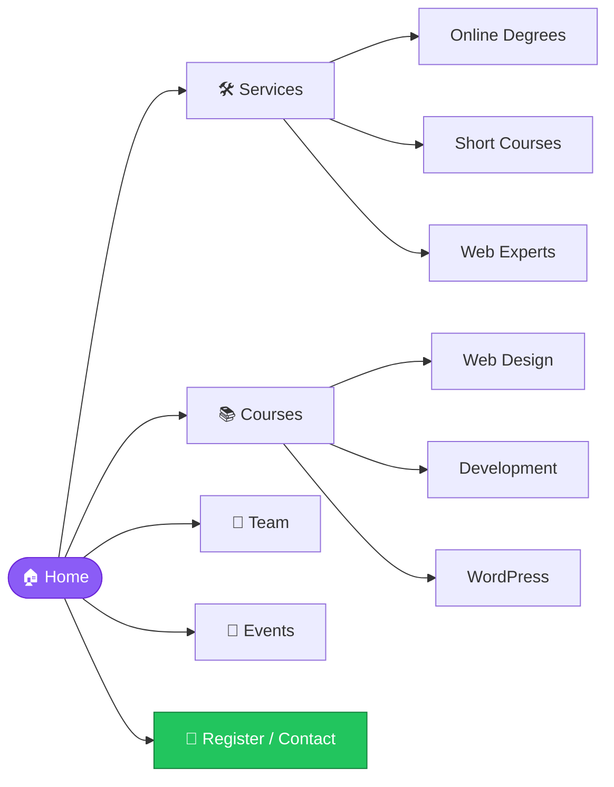

<!-- ===================== HEADER ===================== -->
<div align="center">


<a href="https://vidhyakul.vercel.app">
  
</a>

<br/>

[](https://vidhyakul.vercel.app)
[](https://github.com/MALIK25252007/Vidhyakul)
[](https://vercel.com)


</div>

---

## 📖 About

**Vidhyakul** is a modern, responsive **e-learning platform** that presents online degrees, short skill courses and expert-led programs in one clean, easy-to-navigate website.

It is designed to help students discover courses, meet instructors, explore upcoming events and get in touch quickly, all from a single page that works on desktop, tablet and mobile.

> 💡 *"With Vidhyakul teachers, everything is easier."*

---

## ✨ Features

| | Feature | Description |
|---|---|---|
| 🎓 | **Online Degrees** | Programs such as B.Tech, BBA, MBA, MCA, PGDM, B.Com and BCA |
| ⚡ | **Short Courses** | Web Dev, Full Stack, Video Editing, 3D Animation with Blender, Graphic Design |
| 🛡️ | **Web Experts** | Cybersecurity, Blockchain and cyber-crime detection topics |
| 📚 | **Latest Courses** | Filterable course cards (Web Design, Development, WordPress) with instructor and price |
| 👩‍🏫 | **Meet the Team** | Instructor profiles with social links |
| 💬 | **Testimonials** | What students and mentors say about the platform |
| 📅 | **Upcoming Events** | Workshops with date, duration and price |
| 📊 | **Online Dashboard** | Recorded lectures and learning data in one place |
| 📞 | **Quick Contact** | One-tap WhatsApp links to request a demo or enquire |
| 📱 | **Fully Responsive** | Looks great on every screen size |

---

## 🗺️ Website Structure



---

## 🧰 Tech Stack

- **Markup:** HTML5
- **Styling:** CSS3 + Bootstrap
- **Interactivity:** JavaScript and jQuery plugins (in `vendor/`)
- **Hosting:** Vercel

---

## 📁 Project Structure

```text
Vidhyakul/
├── 📂 assets/        # Images, CSS, JS and fonts
├── 📂 vendor/        # Third-party libraries
├── 📄 index.html     # Main landing page
└── 📄 README.md      # You are here
```

---

## 🚀 Getting Started

**1. Clone the repository**

```bash
git clone https://github.com/MALIK25252007/Vidhyakul.git
cd Vidhyakul
```

**2. Run it locally**

Simply open `index.html` in your browser, or serve it with a local server:

```bash
# using Node
npx serve .

# or using Python
python -m http.server 8000
```

Then visit `http://localhost:8000` 🎉

**3. Deploy**

Import the repo into [Vercel](https://vercel.com) and deploy. No build step is needed, since it's a static site.

---

## 🤝 Contributing

Contributions, ideas and bug reports are welcome!

1. 🍴 Fork the project
2. 🌿 Create your branch: `git checkout -b feature/AmazingFeature`
3. 💾 Commit your changes: `git commit -m "Add AmazingFeature"`
4. 📤 Push to the branch: `git push origin feature/AmazingFeature`
5. 🔁 Open a Pull Request

---

## 📬 Connect with the Developer

<div align="center">

### Tarun Malik · Full Stack Developer

[](https://github.com/MALIK25252007)
[](https://www.linkedin.com/in/tarun-malik-9bab21388)
[](https://www.instagram.com/_malik_200716)

</div>

---

## ⭐ Support

If you like this project, please consider giving it a **star** ⭐ and sharing it with your friends. It really motivates me to keep building!

<div align="center">


Made with 💜 by <a href="https://github.com/MALIK25252007">Tarun Malik</a>

</div>
